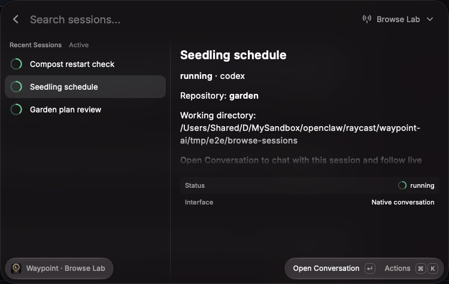
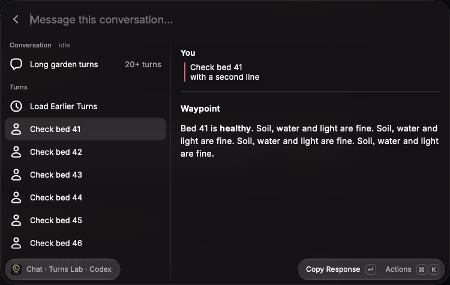
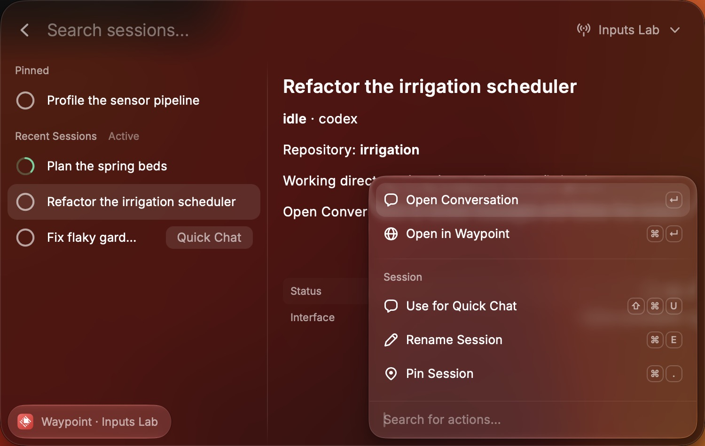
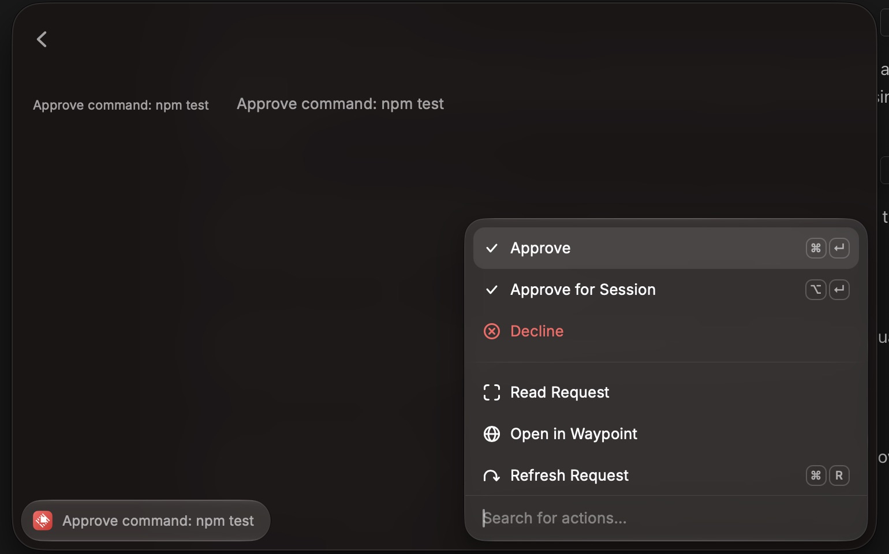
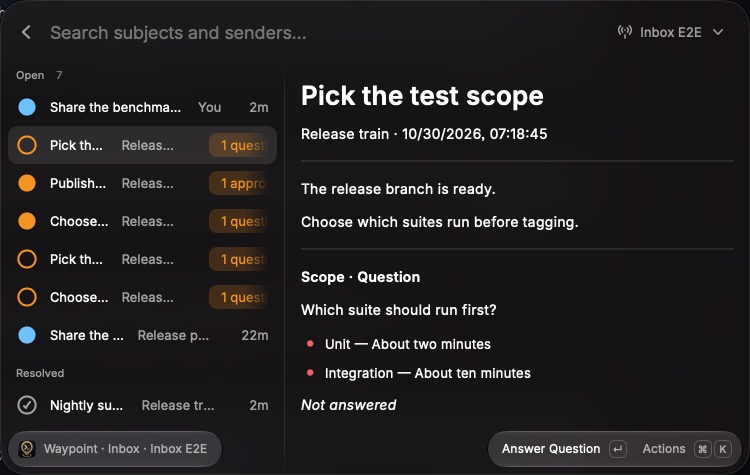
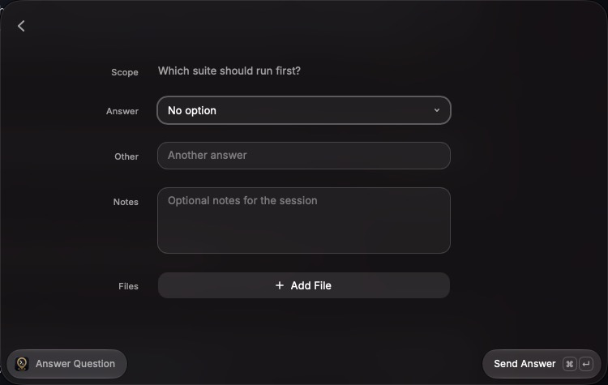
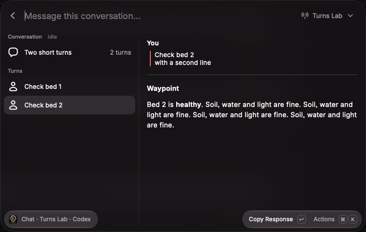
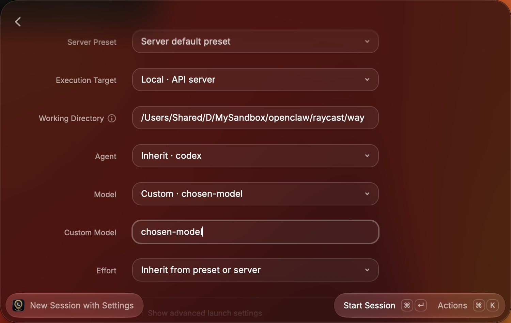
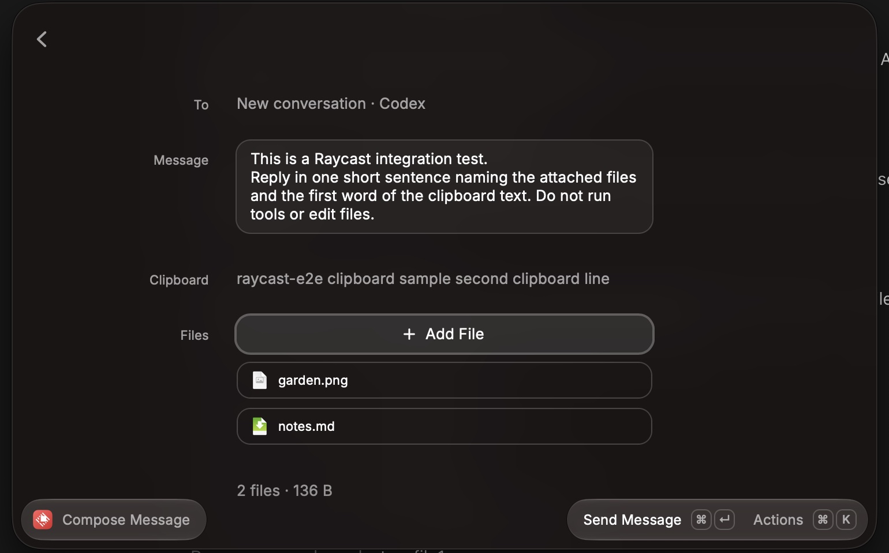
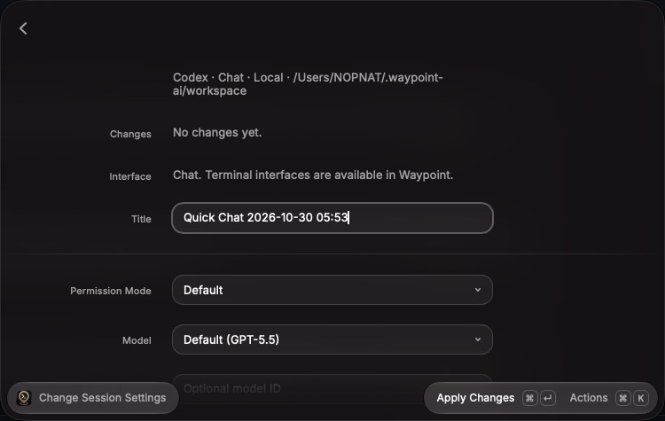

# Waypoint AI

Connect Raycast to your [Waypoint](https://github.com/kaiitunnz/waypoint) servers to chat with coding agents and manage their sessions.

| Command              | What it does                                                                                     |
| -------------------- | ------------------------------------------------------------------------------------------------ |
| Quick Chat           | Continues your Quick Chat conversation on the active server, or prepares a new one on first send |
| New Chat             | Prepares a fresh conversation; earlier sessions keep running                                     |
| Browse Sessions      | Finds sessions, chats with them, and manages them                                                |
| Waypoint Inbox       | Answers the questions, approvals, and notes sessions post to Waypoint's inbox                    |
| Waypoint Inbox Count | Shows open inbox items in the menu bar                                                           |
| Manage Servers       | Adds, signs in to, and switches between Waypoint servers                                         |


## Setup

1. Run a Waypoint API server and note its API URL and server password.
2. Run this extension in Raycast for macOS and open **Manage Servers**.
3. Choose **Add Server**, enter a name and API URL, and save. Add a frontend URL if you want **Open in Waypoint** browser handoff.
4. Choose **Sign in** and enter the Waypoint server password.

The API URL must include `http://` or `https://`. Use its final address: redirects are rejected to protect credentials. Embedded credentials, query strings, and fragments are rejected. URL paths are supported for APIs behind a reverse proxy.

Local execution runs on the API server's machine. SSH execution targets are discovered from that server; they are separate from your saved API connections.

## Managing connections

Select a row to inspect a server. **Use Server** changes the active connection; **Make Default Server** chooses the fallback when the active connection is removed. Reopening restores the active connection. A blue check marks the active server; a star marks the default.

Use Actions to edit, retry, sign in again, remove a connection, or open its configured frontend. Common shortcuts include Add, Edit, Refresh, and Remove. Sign in uses ⇧⌘L; Make Default uses ⇧⌘D.

Reauthentication preserves the connection's identity and setup. Changing its API URL creates a fresh identity and requires sign-in, including when returning to a previously used URL. Removing a connection clears its saved credentials and its Quick Chat defaults, destination, and drafts; sessions keep running on Waypoint.

Bearer tokens are kept in [Raycast's encrypted local storage](https://developers.raycast.com/api-reference/storage). Passwords are used only during sign-in. Connection failures preserve the saved configuration; use Retry Connection or Sign in Again to recover. Unknown or damaged saved-data formats are reported without overwriting the original data.

## Browse Sessions

Find sessions by title, working directory, repository, branch, agent, or status. The server dropdown switches API connections and keeps the current search. Pinned sessions appear first. Show Exited Sessions includes finished sessions; Show Only Exited Sessions narrows the list to them. Protected assistant and telemetry sessions are excluded.

**Open Conversation** opens a chat with a structured session. Terminal and unknown interfaces offer Open in Waypoint using the configured frontend URL. **New Chat** (⌘N) opens New Chat on the server being browsed.



The conversation row shows the loaded turns together in chronological order. Below it, each turn has its own row titled by its prompt, oldest first. The newest turn is selected and stays selected as new turns arrive, until you choose another row. **Load Earlier Turns**, above the oldest turn, loads earlier history until another turn appears; a very long turn can take another press. **Show Conversation** and **Show Latest Turn** (⌘⇧F) switch between the conversation and the newest turn. Copy Response copies the selected turn's answer, and full-width reading shows the selected turn or the whole conversation. Conversation Details shows server-reported context and token usage.

Consecutive tool calls collapse into one line marked ▸ where they happened, such as `▸ 3 commands · 2 files read · 1 file edited (+42 −7)`. **Show Activity** expands each call to its own command, path, or search pattern, with the lines an edit added and removed. Reads and edits count distinct files; the other kinds count calls. An edit that failed or was denied counts as a failed edit, not an edited file. Thinking between calls shows as its own line with a short preview, as in Waypoint, and the calls on either side are summarized separately. Questions and shared files keep their own line. Codex runs file reads as shell commands, so they count as commands.

**Conversation History** opens the detailed event inspector with paired tool activity, filtering, older history, and follow-latest controls. It collapses the same runs into one row, which expands to the individual calls; searching still matches a command or path inside a collapsed run.

Type in the message field and press Enter to send to that session. **Compose Message**, **Include Selected Text**, **Include Clipboard**, attachments, approvals and questions, **Connect SSH Target**, and **Change Session Settings** work as in Quick Chat. An exited session reattaches before the send when its interface can resume it. A session that can't take messages, because it ended and its interface can't resume it or it uses a terminal interface, stays readable and says why. Each session keeps its own message and compose drafts on each server. They are removed when the session is deleted in Raycast, or when its chat finds it deleted elsewhere.

Chatting with a session never changes Quick Chat's destination; **Use for Quick Chat** does (see [Managing sessions](#managing-sessions)). Session chats and Quick Chat share each server's unconfirmed-operation check, so a send waits until it is resolved. Any of them can check or clear it; only the chat that started an operation can allow a retry, and checking never switches another chat's conversation.

Reconnects catch up on missed events and preserve loaded history. After a long absence, the conversation shows its latest activity with a notice that some is missing; **Reload Conversation** starts it again from the latest activity. Expired sign-in offers reauthentication. The conversation content remains in memory and is not saved to extension storage.



## Managing sessions

Session actions appear in the Actions panel of each Browse Sessions row and of session chats. Each action checks the session's current state with Waypoint first, so an action on an outdated row does nothing and says so.

| Action             | Available when                                                   | Shortcut |
| ------------------ | ---------------------------------------------------------------- | -------- |
| Use for Quick Chat | The session has a native conversation and can continue           | ⇧⌘U      |
| Rename Session     | Always                                                           | ⌘E       |
| Pin / Unpin        | Always                                                           | ⌘.       |
| Interrupt Session  | A native conversation is starting, running, or waiting for input | ⇧⌘I      |
| Reattach Session   | The session exited or failed and its interface can resume it     | ⇧⌘T      |
| Terminate Session  | The session has not exited                                       | None     |
| Delete Session     | The session exited or failed                                     | ⌃X       |

**Terminate** stops the agent and asks for confirmation first. Terminating a terminal session that is attached to your own tmux session leaves your tmux session running. A terminated session leaves the active list; the success toast offers **Show Exited Sessions**. Terminating Quick Chat's destination also moves Quick Chat to a new conversation, unless Quick Chat has an unconfirmed operation to check first.

**Delete** asks for confirmation and cannot be undone. Waypoint removes the session's transcript, attachments, scheduled messages, board posts, and any manager backlog it owns. If Waypoint created a git worktree for the session, the worktree is removed, including uncommitted changes, along with its branch if that branch is merged. Terminate a running session before deleting it.

**Reattach** restarts the agent and resumes its conversation. If the session runs on an SSH target that uses a password and isn't connected, Raycast asks for the password once, connects, and reattaches.

**Use for Quick Chat** makes the session Quick Chat's destination on that server and opens Quick Chat on it. Opening or chatting with a session from Browse Sessions never changes the destination. The current destination shows a **Quick Chat** tag in the list, and its action becomes **Open in Quick Chat**. If the session is later deleted, Quick Chat explains it and **Start New Chat** clears the destination.

The personal assistant and telemetry sessions are not listed. An open conversation notices within 20 seconds when its session is deleted elsewhere.



## Approvals and questions

Pending approvals, plan approvals, and agent questions appear under **Needs Attention** above the conversation in Quick Chat, session chats, and Conversation History. Review a request to see its context and respond: approvals offer the decisions the agent supports and an optional note where supported; plans accept a note; questions take single or multiple choices, notes, and free-text answers. Answers in progress are saved, so closing the form keeps them. **Cancel Question** tells the agent to continue without an answer; closing the form does not.

As in Waypoint's web app, approvals and plans are found in the conversation history that has been loaded. A request older than that appears after loading earlier messages, or in Waypoint. When earlier activity is missing after a long absence, reload the conversation first.

A form stays bound to the request it opened. If the request is answered elsewhere or replaced, the form shows that and sends nothing. Requests the agent's interface cannot handle natively, such as unsupported question formats or requests without a stable ID, offer **Open in Waypoint**.

If Waypoint does not confirm a response, nothing is retried. **Check Previous Outcome** shows whether the request is still pending, or says when the loaded history cannot confirm it. **Clear Checkpoint** continues once it is resolved; **Allow Another Attempt** warns that responding again can repeat its effect. Until then, other responses and Quick Chat sends on that server wait.



## Waypoint Inbox

**Waypoint Inbox** lists the items sessions post with `waypoint inbox`. Approvals, plans, and questions raised inside a conversation stay under that chat's Needs Attention. It shows open items; **Show Resolved Items** (⌘⇧E) adds resolved ones below. The list loads more as you scroll and follows changes made anywhere on the server. Search matches subjects and senders. A row's icon is orange when the item waits on you and filled while it's unread; tags count unanswered questions and approvals.



- **Answer Question** opens a form with the options, an **Other** answer, notes, and files. **Reply** adds notes and files to any part of an item.
- Each approval decision is its own action; **Change Decision** re-answers an answered approval.
- **Open Session** opens the session that posted the item; **Open in Waypoint** opens the item in the web app.
- **Delete Item** (⌃X) and, while resolved items are shown, **Delete Resolved Items** (⌃⇧X). Delete Resolved Items removes resolved items on the whole server, including ones not loaded.

Answering or replying wakes the posting session; an item resolves once its required questions and approvals are answered. An item with nothing to answer resolves, and wakes its session, when it's read. An item is marked read only when you act on it, stay on it after moving to it, choose **Mark as Read** (⌘⇧R), or open it from the menu bar.

A reply replaces the earlier one on that part of the item; the form opens with its notes and keeps its files. Files go to the posting session's attachments, up to 25 MB each; items a person posted take notes only. Drafts are kept per part until sent. If Waypoint doesn't confirm a send, the form checks whether it was recorded; sending again is safe.



**Waypoint Inbox Count** shows the number of open items on the active server in the menu bar. Its icon is blue while items are open and orange when a listed item waits for an answer. The menu lists up to ten open items; choosing one opens it in Waypoint Inbox. It refreshes every five minutes, when opened, and after changes made in Waypoint Inbox.

## Quick Chat

Type in the top message field and press Enter to send. Follow-ups continue the same Waypoint session. The conversation row keeps loaded turns together in chronological order, with its turn count, and each turn has its own row below it, as in session chats. Sending selects the new turn. Consecutive tool calls collapse into one line; **Show Activity** expands them. Activity details, copying or pasting a response, full-width reading, and session information are available in Actions. The side panel shows the first 4,000 characters of a very long message; full-width reading shows all of it.



Quick Chat continues its own conversation for each saved server. The default timeout is 30 minutes after the last successful user send, or after you chose the session with **Use for Quick Chat**, whichever is later. Running work and unresolved approvals, questions, or plans keep their conversation. **Quick Chat Defaults** offers Always Continue, Always New, and a configurable timeout. **New Chat** and **Start New Chat** prepare a fresh conversation; creation happens on first send, and existing sessions keep running. With Always New, **Open in Quick Chat** in Browse Sessions returns to the chosen session.

**New Session with Settings** (⌘⇧N) starts a session from settings you choose, leaving Quick Chat Defaults as they are. The form starts from the defaults and keeps your changes if Raycast closes; **Discard Draft** resets it. **Start Session** creates the session right away, without a message, and Quick Chat shows it ready for your first one. Until you send it, reopening the command you started it from returns to that session in every reuse mode, and **Start New Chat** moves on. Timed reuse counts from when it started.



Each new session is titled with the time it was created, such as `Quick Chat 2026-10-27 14:05`, in this Mac's local time.

When the server runs on this Mac and no working directory is set, sessions on the Local target start in `~/.waypoint-ai/workspace`. Raycast creates the folder on first use with an `AGENTS.md` describing it as a scratch workspace and a `CLAUDE.md` that imports it; edits to either file are kept. Other servers and SSH targets use the target's or server's default directory.

**Terminate Session** (⌃⇧X) ends the current session after confirmation and moves Quick Chat to a new conversation, keeping the draft. The terminated session stays in Browse Sessions, where **Reattach Session** or **Use for Quick Chat** brings it back.

**Terminate and Delete Session** (⌃X) ends the session and deletes it in one step, then moves to a new conversation, keeping the draft. For a session that has already exited, the action is **Delete Session**.

Defaults apply to new conversations. Choose the server preset, execution target, working directory, agent, model, and effort. Advanced settings expose supported transport, account profile, permissions, arguments, and configuration overrides. Inherited settings and private preset values are resolved by Waypoint. Each saved server keeps its own defaults and draft.

Drafts survive closing the command. Reopening catches up with Waypoint without resending. Rejected sends keep the draft and an already-created session. **Interrupt Session** is explicit; exited sessions reattach before sending when their transport supports it.

Sends to one server run one at a time across extension commands. A command waits a few seconds for another one's send to finish; a command that stopped mid-send releases the server after 30 seconds.

An unconfirmed operation blocks further sends. **Check Previous Outcome** inspects the session and history without resending. Matching recorded input does not establish agent delivery. **Allow Explicit Retry** warns that another attempt may duplicate work. **Abandon Attempt and Start New Chat** discards the local checkpoint after confirmation; existing sessions keep running. Coordination covers extension commands on this computer, not other devices.

## Composing messages

**Compose Message** opens a multiline form for the current destination, which it names at the top. Text already typed in the message field moves into an empty draft. Each saved server keeps one compose draft for Quick Chat, one for New Chat, and one for each session chat; closing the form keeps it, and **Discard Draft** removes it.

**Include Selected Text** and **Include Clipboard** read the selection or clipboard once and stage it in the form, where it can be reviewed or removed before sending. **Include Clipboard** attaches copied files, or else a copied image as a PNG, and otherwise stages the copied text, as the Waypoint web app does when pasting. Staged text is sent verbatim in a fenced block after the message. An item can be up to 256 KB, and a draft can hold up to 1 MB.

Files and images can be attached when the agent accepts attachments. They upload to Waypoint when you send, up to 25 MB each, and the message carries the uploaded files. Agents on a remote execution target receive only the files Waypoint can deliver there: OpenCode takes files and images, Claude Code takes images, and other agents take none. If a send fails, the draft keeps its files, and uploads that are still valid are reused on retry. When the agent can't take a copied file or image, **Include Clipboard** says why; a copy that also carries text, such as spreadsheet cells, stages the text instead. The extension keeps a copied image in its support folder until the message is sent or the image is removed; images left behind are deleted later.



When a send needs a password-auth SSH target that is not connected, **Connect SSH Target** asks for its password. Waypoint uses it once to connect, then the send or reattach continues. The password is not saved.

## Changing session settings

**Change Session Settings** (⌘⇧,) changes the open conversation's own settings, separate from Quick Chat Defaults, which shape future chats. It opens from Quick Chat, New Chat, and session chats, and loads the session's current settings and capabilities from Waypoint each time.

The form offers what can change on the running session, as the Waypoint web app's Session Settings does. The top line shows the agent, interface, execution target, and working directory, which stay fixed for a session; **New Session with Settings** starts a session with different ones. Below it come the interface, account profile, title, permission mode, model, and effort, then an Advanced group: usage source, custom arguments, configuration overrides, and environment variables. Each field appears only when the session's agent and interface support it. Interface switching offers structured interfaces only, since Raycast shows structured conversations; terminal interfaces stay in Waypoint.

The form previews what applying does. Inline changes apply at once. Changes that restart the session list how many restarts they cause, that the conversation resumes, and whether a running turn is interrupted; applying them asks for confirmation. Changes apply in the order Waypoint's web app uses. If a later change fails, the form lists the changes that were applied, shows the failure, and reloads the session's current settings; applying again sends only what is still pending.



Environment values are never shown or stored. Each existing variable can be kept, replaced, or removed, and variables Waypoint manages are hidden. New variables go in the empty row at the end of the form, and another empty row appears as you type; **Add Environment Variable** (⌘N) jumps to it. A new variable can't reuse a stored name; replace the stored one instead. Model, effort, and permission changes need a running session: exited sessions offer **Reattach Session**, and starting sessions ask you to wait.

## Agents and interfaces

Raycast reads each agent's capabilities from Waypoint, so the controls follow the server. A current Waypoint server reports:

| Agent       | Interface | In Raycast          | Model                | Effort               | Attachments |
| ----------- | --------- | ------------------- | -------------------- | -------------------- | ----------- |
| Codex       | Chat      | Native conversation | Applies at once      | Applies at once      | Yes         |
| Claude Code | Chat      | Native conversation | Applies at once      | Restarts and resumes | Yes         |
| Claude Code | Emulated  | Native conversation | Restarts and resumes | Restarts and resumes | Yes         |
| OpenCode    | Chat      | Native conversation | Applies at once      | Applies at once      | Yes         |
| Any agent   | Terminal  | Open in Waypoint    | In Waypoint          | In Waypoint          | In Waypoint |

On a remote execution target, Raycast sends only the attachments Waypoint can deliver there; see [Composing messages](#composing-messages).

## Known limitations

- Waypoint has no idempotency key for creating sessions or sending messages. When an operation's outcome is unconfirmed, Raycast keeps a checkpoint for that server and resends nothing until you check the outcome or explicitly allow another attempt. The checkpoint coordinates the extension's commands on this computer, not other devices.
- When a new session fails to start on its execution target, for example because its working directory doesn't exist there, Waypoint leaves a failed **Quick Chat** session without the tags Raycast uses to find its own sessions. **Check Previous Outcome** recognizes it when the server's clock is within five minutes of this Mac's; otherwise, abandon the attempt. Delete the failed session from Browse Sessions afterwards.
- Pressing Escape in Quick Chat or a session chat clears the message field, as in any Raycast search bar. Use **Compose Message** for drafts you want to keep while navigating.
- A server reached through a local port, such as an SSH tunnel or a container, counts as running on this Mac but can't see `~/.waypoint-ai/workspace`. Quick Chat then asks for a working directory; set one in **Quick Chat Defaults**.

## Development

Use Node.js 22 or newer and npm. Raycast is required to run the extension.

```sh
npm ci
npm run dev
```

Run the full gate before committing:

```sh
npm run verify
```

The gate checks formatting, ESLint, strict TypeScript, behavior and HTTP integration tests, Raycast manifest/icon validation, and the extension build. HTTP tests require permission to bind loopback sockets; Raycast validation requires network access. `npm test` runs the focused tests separately.

Source is organized into thin command entries, `api/`, `domain/`, `storage/`, `hooks/`, `views/`, and `components/`. Tests compile into an ignored temporary build directory using the installed TypeScript compiler and Node's test runner.

See [CONTRIBUTING.md](CONTRIBUTING.md) for contributor guidance and [connection acceptance](docs/server-connections-acceptance.md), [conversation acceptance](docs/session-conversations-acceptance.md), [Quick Chat acceptance](docs/quick-chat-acceptance.md), [session interactions acceptance](docs/session-interactions-acceptance.md), [desktop inputs acceptance](docs/desktop-inputs-acceptance.md), [session settings acceptance](docs/session-settings-acceptance.md), [session management acceptance](docs/session-management-acceptance.md), [long session acceptance](docs/long-session-acceptance.md), [tool activity acceptance](docs/tool-activity-acceptance.md), [Quick Chat cleanup acceptance](docs/quick-chat-cleanup-acceptance.md), [New Session with Settings acceptance](docs/new-session-settings-acceptance.md), and [Browse Sessions acceptance](docs/browse-sessions-acceptance.md) for runtime coverage.
