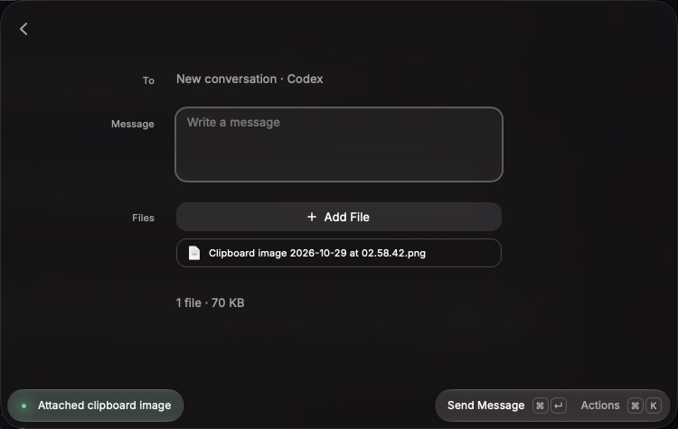

# Clipboard attachments acceptance

The macOS Raycast pass used the development extension against an isolated Waypoint API with a disposable password and data directory, added as a temporary server and removed afterwards. It ran Waypoint's actual authentication, attachments, WebSockets, and Codex adapter, with a fake Codex SDK client in place of the agent and a fake password-auth SSH target. Raycast was driven with keystrokes, and outcomes were checked in screenshots, the accessibility tree, the attachments and input events Waypoint stored, the input the fake agent received, and the folder Raycast keeps copied images in. Clipboard contents were synthetic: generated PNGs, file URLs for generated files, and plain text, written to the pasteboard directly. The pasteboard was backed up before the pass and restored byte for byte afterwards. The user's own Waypoint server was not used.

## Desktop coverage

| Scenario                                                            | Observed result                                                                                                                                                                              |
| ------------------------------------------------------------------- | -------------------------------------------------------------------------------------------------------------------------------------------------------------------------------------------- |
| Copy image data, then Include Clipboard from Quick Chat             | Compose Message opened with one file named “Clipboard image 2026-10-29 at 02.58.42.png” and the toast “Attached clipboard image”                                                             |
| Send that draft                                                     | Waypoint stored a PNG and recorded it as an image on the input; the agent received it as a local image; Raycast's copy was deleted                                                           |
| Copy two files, as Finder does, then Include Clipboard from chat    | Both files were attached, with the toast “Attached 2 files”; sending delivered an image and a file, and the copied files were left in place                                                  |
| Copy text and press Include Clipboard at once                       | The new text was staged as clipboard context                                                                                                                                                 |
| Copy image data in a chat whose Codex session runs on an SSH target | The toast named the reason (“Attachments don't reach this agent on a remote target.”); nothing was staged or written                                                                         |
| Copy an image with text on that session                             | The text was staged, and the toast said the image was not attached                                                                                                                           |
| Copy a file on that session, from Compose Message                   | The reason was shown; the file's name was not staged as text                                                                                                                                 |
| Discard Draft with a copied image                                   | Raycast's copy was deleted                                                                                                                                                                   |
| Send a copied image when Waypoint fails the input with a 500        | The send was unconfirmed; the draft and Raycast's copy were kept                                                                                                                             |
| Allow Explicit Retry, then send the kept draft to a new chat        | Both copied images were delivered, then deleted. A retry to the original session was rejected first, since restarting the harness had dropped its fake agent; the draft and copies were kept |
| Open Quick Chat with an unreferenced copy older than an hour        | The collector deleted it                                                                                                                                                                     |
| Read the pasteboard and save an image, outside Raycast              | 56–69 ms over five runs                                                                                                                                                                      |

Raycast's own clipboard API reported the previous copy for a moment after a new one, so text is read from the pasteboard directly.

Not exercised natively: TIFF-only image copies (the conversion was checked by hand with the same script calls), copies over 25 MB, a native read that times out, and large text spilled to Raycast's clipboard history. Tests cover the last three.

## Automated coverage

`npm run verify` checks formatting, ESLint, strict types, 335 behavior and integration tests, Raycast validation, and build.

Tests cover:

- **Choice:** copied files beat image data, which beats text; spilled text stays text; an empty clipboard and a failed read are told apart; an agent that takes no attachments refuses copied files and images, and an image that comes with text stages the text; images-only targets still take copied files, which the send checks.
- **Reading:** every copied file is reported; the text comes from the pasteboard; the limit and image path are passed as arguments; a failed read falls back to Raycast's file, then its text.
- **Staging:** the policy is checked before anything is written; an image that never entered the draft is deleted at once; one whose save failed is left for collection.
- **Cleanup:** a confirmed send, removal, and discard delete copied images and keep picked files; a failed final save and an unconfirmed send keep them; another server's saved state, even damaged, protects what it names; the collector deletes only unreferenced, partial, or missing images older than an hour inside its folder, reads storage only when one is that old, runs at most every ten minutes across processes, and deletes nothing when storage can't be read.
