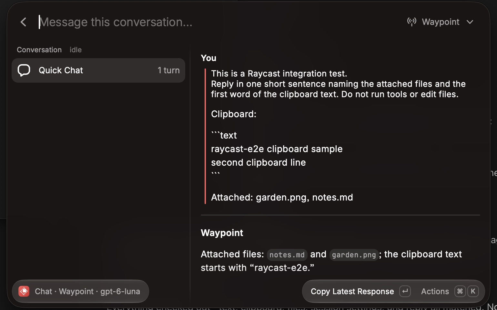

# Desktop inputs acceptance

The macOS Raycast pass used the development extension in two setups.

The isolated pass ran an isolated Waypoint API with a disposable password and data directory. It used Waypoint's actual authentication, sessions, attachment upload and storage, input, WebSockets, and the Codex adapter and plugin. A fake Codex SDK client replaced the agent, so the checks compared what the agent received with what was composed. A fake password-auth SSH target had its ControlMaster connect and status patched, so no SSH connection was made. Fixture middleware failed or delayed one upload on demand.

The real-server pass ran against the user's own Waypoint server. It created one Quick Chat session with Codex (GPT-6-Luna, low effort, Auto review) in a scratch folder, recorded its ID, and deleted it with the Waypoint CLI afterwards; the server's session list matched its baseline. Quick Chat defaults were recorded before the pass and restored afterwards.

Both passes drove Raycast with keystrokes. Each outcome was checked against the server's stored events and the agent's received input.

## Desktop coverage

| Scenario                                                                               | Observed result                                                                                                                                             |
| -------------------------------------------------------------------------------------- | ----------------------------------------------------------------------------------------------------------------------------------------------------------- |
| Compose a multiline message with clipboard context, an image, and a file (real server) | The agent receives both lines, the clipboard text fenced under "Clipboard:", `garden.png` as an image and `notes.md` as a file, and names them in its reply |
| Include Selected Text from a TextEdit selection                                        | The selection is staged before sending and arrives verbatim with its line breaks                                                                            |
| Stage about 1 MB of clipboard context                                                  | Four 243 KB items are staged; a fifth is refused at the draft limit; the 972,961-byte message arrives intact                                                |
| Copy about 243 KB of text and choose Include Clipboard                                 | The full text is staged, not the name of the file Raycast's clipboard history keeps it in                                                                   |
| Upload fails                                                                           | The draft and its files are kept; the retry sends both files                                                                                                |
| Close Raycast during a slow upload                                                     | The send finishes in the background and the server lock is released                                                                                         |
| Relaunch Quick Chat during a slow upload                                               | The stopped instance's lock is reclaimed once its heartbeat is 30 seconds old; the next send succeeds and the stopped instance leaves no lock files         |
| Send to a password-auth SSH target that is not connected                               | Connect SSH Target asks for the password; a wrong password shows the target's error; the right one resumes the send; nothing is saved                       |
| Remote Codex target                                                                    | The file picker is replaced by a note that attachments don't reach this agent on a remote target                                                            |
| Type in Compose                                                                        | Each keystroke saves its draft in 1–4 ms and does not re-render the conversation beneath the form                                                           |
| Type in the message field of a conversation holding a ~1 MB message                    | Keystrokes keep pace; the side panel shows 4,000 characters of that message and points to Read Conversation at Full Width                                   |
| Close the window or press Esc while composing, then reopen                             | Text, context, and files are restored                                                                                                                       |
| Discard Draft                                                                          | Text, context, and files are removed after confirmation                                                                                                     |
| Send while text is typed during the send                                               | The sent text is cleared; text typed during the send is kept                                                                                                |
| Paste Latest Response (real server)                                                    | The agent's reply is pasted into the frontmost document                                                                                                     |
| Open Quick Chat when its saved conversation was deleted                                | Needs Attention explains it and points to Start New Chat; the draft is kept                                                                                 |

The pass found and fixed several issues before the final checks:

- A stopped command could hold the server lock indefinitely.
- Large copied text was staged as a file name.
- Typing ran a locked save of all Quick Chat state on every keystroke.
- One very large message made the message field take seconds per character.
- Compose named the server's default agent instead of the preset's.

Not exercised natively:

- Waypoint's upload size rejection and an expired upload being re-uploaded during a send.
- Key-auth SSH targets.
- Remote delivery for OpenCode and Claude Code.
- A real SSH host.
- Windows.

Unit and integration tests cover these paths.

## Automated coverage

`npm run verify` checks formatting, ESLint, strict types, 135 behavior and integration tests, Raycast validation, and build.

Desktop input tests cover:

- **Composition and context:** composed-message fencing, context limits, and moving the search-bar text into Compose.
- **Attachments:** attachment types and size limits, capability and remote-target rules, multipart uploads with image types, upload reuse and expiry, partial upload failures, and refreshing missing attachments.
- **SSH targets:** password connection and resume.
- **Drafts and locking:** per-key draft storage with coalesced writes and carried-over drafts, the server lock's heartbeat lease and fencing, stopped-holder cleanup, and clearing only sent text.
- **Presentation:** collapsing oversized messages in the preview.

## Screenshots

