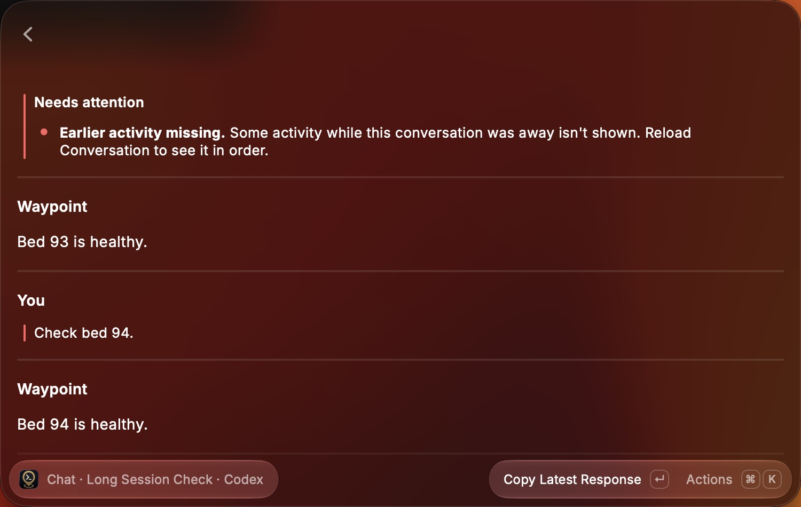

# Long session acceptance

The macOS Raycast pass used the development extension in two places.

On the user's own Waypoint server, only read-only checks were made. The longest live Claude Code session there returns 141.7 MB when its full history is read and 0.56 MB for its latest page. It was opened from Search Sessions, and the pass then pressed Esc, moved the selection, opened another conversation, and opened the long one again. Nothing was sent, and Quick Chat state was untouched.

The other checks used an isolated Waypoint API with a disposable password and data directory. It ran Waypoint's actual authentication, paging, pending-question snapshots, storage, WebSockets, and Codex adapter, with a fake Codex SDK client in place of the agent. Sessions were seeded with long histories written straight to storage; the longest returns 31.7 MB when read in full and 78 KB for its latest page. The server logged every events query. Raycast was driven with keystrokes, and outcomes were checked in screenshots and against the server's stored events.

## Desktop coverage

| Scenario                                                                         | Observed result                                                                                                                     |
| -------------------------------------------------------------------------------- | ----------------------------------------------------------------------------------------------------------------------------------- |
| Open the 141.7 MB session on the real server, then Esc                           | The list keeps responding and other conversations open; no crash report is written and the Raycast Backend process keeps running    |
| Open a 31.7 MB session with a pending approval                                   | Needs Attention lists the approval from the latest page                                                                             |
| Approve it                                                                       | Waypoint records the response with its ID and Needs Attention clears                                                                |
| Open it in Quick Chat with Use for Quick Chat                                    | Quick Chat continues the session from its latest page                                                                               |
| Open a long plan-mode session with a plan                                        | Needs Attention lists the plan approval                                                                                             |
| Open a long session with a question                                              | Needs Attention lists the question from the page's question snapshot                                                                |
| Open a session whose approval is older than the latest page                      | No request is shown; after Load Earlier Messages, the approval appears                                                              |
| Push Conversation History, add 200 turns, and return                             | The conversation shows its latest activity with the gap notice; Reload Conversation clears it and starts again from the latest page |
| Answer an approval outside Raycast, add 40 turns, then open Conversation History | Neither Conversation History nor the conversation shows the request                                                                 |
| Every events query the extension sent (42)                                       | 36 latest pages and 6 `before_sequence` pages; none read the full history                                                           |

Not exercised natively:

- Conversation History's own gap notice. Tests cover the feed's gap tracking that drives it.
- Check Previous Outcome when the loaded history doesn't reach the latest page. Tests cover pending, resolved, and the case with no verdict.
- A resume that fails and then bridges back to where the hole opened. Tests cover it.

## Automated coverage

`npm run verify` checks formatting, ESLint, strict types, 220 behavior and integration tests, Raycast validation, and build.

Tests cover:

- **Requests:** approvals and plans from the feed's loaded history only, including earlier pages it loaded and nothing before a gap; the feed holding the newest history wins; an empty feed snapshot keeps the previous history; Reload replaces it and keeps a pending question; drafts are kept while the session can still ask.
- **Responses:** a request in an earlier loaded page is checked against a fresh latest page that meets it; Check Previous Outcome reports pending, resolved, or no verdict, and keeps the checkpoint when it can't tell.
- **Resume:** a small gap is bridged; a large one sets the notice after five earlier pages and keeps it until Reload; a failed resume counts requests only past the hole until a later resume bridges it.
- **Quick Chat:** checking an unconfirmed message pages back only to the history before it was sent, ignores the same message sent earlier, and stops after 20 pages; reattach and interrupt checks read no history; timed reuse and New Chat's empty-session check use the latest page.
