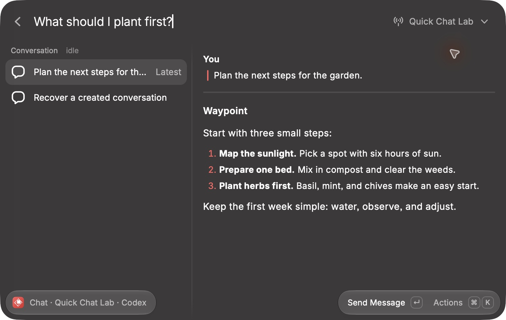

# Quick Chat acceptance

The macOS Raycast pass used the development extension and disposable Waypoint API instances. The chat instance used Waypoint's actual authentication, preset resolution, session/input/action routes, storage, WebSockets, and session-state broadcaster. A deterministic in-process transport replaced agent execution; agent launch and monitoring were disabled. No private sessions or model calls were used. The screenshot displays a sanitized stored Markdown response.

## Desktop coverage

| Scenario                                          | Observed result                                                                               |
| ------------------------------------------------- | --------------------------------------------------------------------------------------------- |
| Open Quick Chat before first send                 | Prepared view; database session count remained zero                                           |
| Save defaults                                     | Native form saves reuse timeout and returns to the same conversation                          |
| Close and reopen with a draft                     | Message text restores without sending                                                         |
| First send and follow-up                          | One created session, multiple input events; successful sends clear the input                  |
| Browse an older exchange with a draft             | Draft stays visible; Enter sends to the current conversation and selects the latest exchange  |
| Stream assistant output                           | Response updates inside the selected exchange; composer remains on screen                     |
| Open New Chat command                             | Prepares a fresh conversation with a separate draft                                           |
| Start New Chat                                    | Predecessor remains; creation waits for the first send                                        |
| Reopen an expired idle session                    | Prepares a new conversation                                                                   |
| Reopen expired running work                       | Keeps the running conversation                                                                |
| Switch saved servers and return                   | The second server has a separate draft; the first server restores its text                    |
| Reject input                                      | Draft remains; retry uses the existing session                                                |
| Input times out after server recording            | Recovery blocks Send; checking the outcome and authorizing retry produces no automatic resend |
| Creation times out after storing a tagged session | Outcome check recovers the created session; its input count stays zero until an explicit send |
| Interrupt running work                            | Session status becomes interrupted                                                            |
| Reattach an exited session                        | Same session becomes idle without an input event                                              |

The native composition field and transcript share one List view. Turns group user text with formatted assistant output; tools remain secondary. Server and session browsing retain the existing Raycast design. Native Markdown preserves selectable text; custom bubble styling is unsupported by Raycast. There is no separate default composition page.

## Automated coverage

`npm run verify` covers formatting, ESLint, strict TypeScript, 69 behavior/integration tests, Raycast validation, and build. Quick Chat tests cover timeout boundaries and all reuse modes, unresolved interaction evidence, preset omission and ownership tags, concurrent opens, per-session send clocks, draft isolation, rejected and uncertain writes, create recovery, missing destinations, explicit abandonment, late acknowledgements, final storage-write failure, cross-process coordination, dead owners, and a process killed during reclamation. Chat presentation tests preserve complete user text and assistant Markdown while grouping turns.

## Coverage limits

Windows, real agents, SSH launch/password flows, and adapter-backed model discovery were not exercised. The isolated API has no initialized model adapter, so model discovery shows its recoverable error. Always Continue/Always New and deleted-target abandonment are covered by controller tests. The Actions popup and browser handoff were not verified with computer use; native shortcuts exercised the tested secondary actions. No automated desktop suite is present.

## Screenshots

