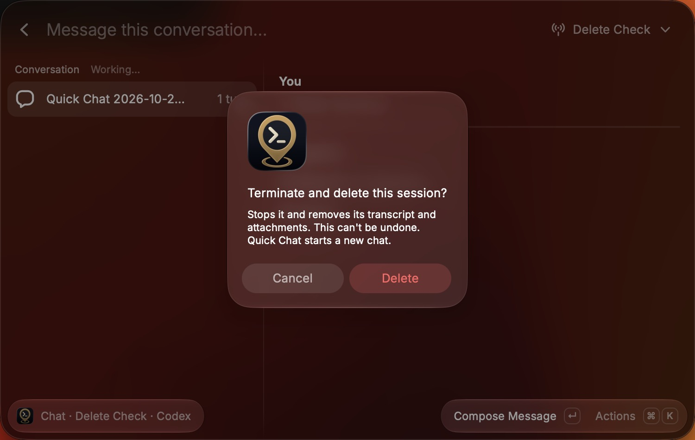

# Quick Chat cleanup acceptance

The macOS Raycast pass used the development extension against an isolated Waypoint API with a disposable password and data directory, added as a temporary server and removed afterwards. It ran Waypoint's actual authentication, sessions, deletion, WebSockets, and Codex adapter, with a fake Codex SDK client in place of the agent. A fixture switch made the next session delete a definite refusal. Raycast was driven with keystrokes, and outcomes were checked in screenshots and against the server's session list.

On the user's own Waypoint server, only a read-only check was made: a long conversation was opened to see the tool-run marker. Nothing was sent, and Quick Chat state was untouched.

## Desktop coverage

| Scenario                                            | Observed result                                                                                                                                                    |
| --------------------------------------------------- | ------------------------------------------------------------------------------------------------------------------------------------------------------------------ |
| ⌃X in Quick Chat on a running session               | "Terminate and delete this session?" with a short message; Delete removes the session from the server, and Quick Chat shows a new conversation with the draft kept |
| ⌃⇧X in Quick Chat                                   | "Terminate this session?"; the session exits, the toast confirms it, and Quick Chat shows a new conversation                                                       |
| ⌃X when Waypoint refuses the delete                 | "Couldn't delete session" with Waypoint's reason; Quick Chat stays on the session                                                                                  |
| Terminate Quick Chat's session from Search Sessions | The confirmation says Quick Chat starts a new chat; the session exits, and Quick Chat then opens a new conversation                                                |
| Quick Chat's session exited outside Raycast         | The action reads Delete Session; "Delete this session?" removes it                                                                                                 |
| A long conversation on the real server              | Each collapsed tool run starts with ▸; thinking lines stay plain italic                                                                                            |

Not exercised natively: a delete whose result is unconfirmed, one that ends the session without deleting it, and Terminate from Search Sessions while Quick Chat has an unconfirmed operation or another command holds the server lock. Tests cover them.

## Automated coverage

`npm run verify` checks formatting, ESLint, strict types, 255 behavior and integration tests, Raycast validation, and build.

Tests cover:

- **Quick Chat:** terminating and deleting a live or exited session in one request; the draft, its text, and its staged files kept without uploads to the deleted session; a refusal restoring the session; an unconfirmed result or an exited session that may still be deleting moving on as unconfirmed; a session that ended without being deleted reported apart from a deleted one; a session already gone.
- **Search Sessions:** terminating Quick Chat's destination or a session a draft is bound to releases it, and only a definite refusal puts it back; with an unconfirmed operation the terminate goes through and Quick Chat keeps the session; a server lock held by another command doesn't stop the terminate; other sessions take no lock.
- **Delete:** a live session is deleted only through Terminate and Delete; uncertain, refused, partial, and gone outcomes; a refused plain delete leaves Quick Chat alone.
