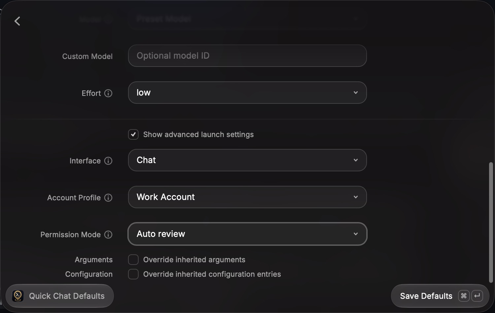
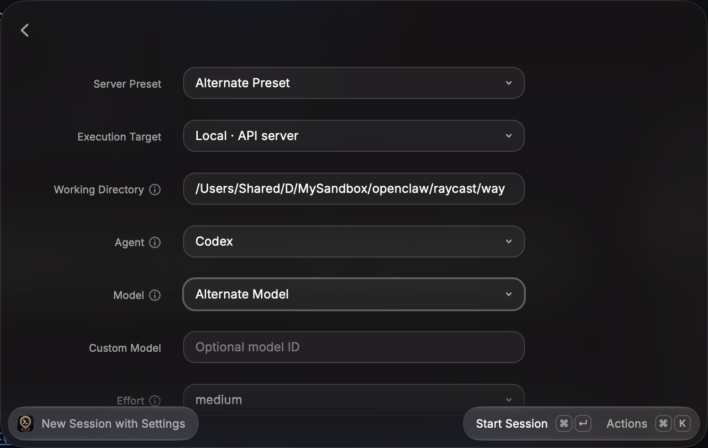
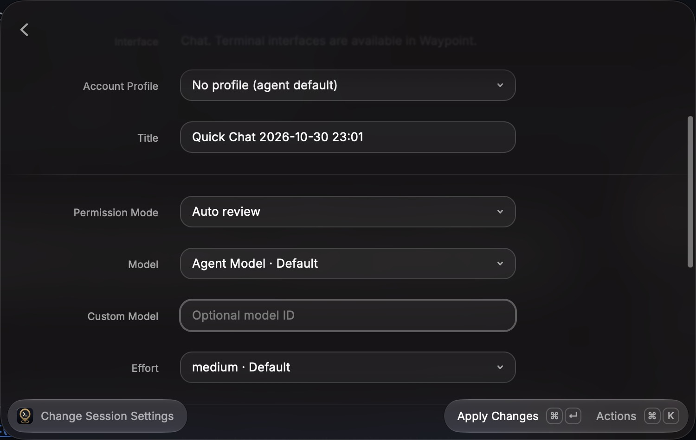

# Effective session settings acceptance

The native pass ran on macOS on 2026-10-30 using the `raycast-e2e` skill, the development extension, and an isolated real Waypoint API on loopback port 18809. Its agent was a fake SDK client; no model calls or SSH connections were made. Two synthetic presets used different models, effort levels, permission modes, and account profiles. Screenshots show synthetic session data.

Each scenario was checked in Raycast through accessibility or a screenshot and against the harness's recorded request fields and stored sessions. The temporary connection was `e2e-resolved-settings`.

| Scenario                                                                               | Observed on screen                                                                                                                                                                            | Request or stored-state check                                                                                                                                                    |
| -------------------------------------------------------------------------------------- | --------------------------------------------------------------------------------------------------------------------------------------------------------------------------------------------- | -------------------------------------------------------------------------------------------------------------------------------------------------------------------------------- |
| Open Quick Chat Defaults without editing launch settings                               | Team Preset · Server default; Codex; Preset Model; low; Chat; Work Account; Auto review. The empty directory shows the effective workspace placeholder.                                       | Saving and creating afterwards sent no model, effort, account profile, or permission override.                                                                                   |
| Start New Session with Settings from those defaults                                    | The same inherited values are visible; the created chat opens ready to use.                                                                                                                   | Waypoint stored preset-model, low, work, and auto_review.                                                                                                                        |
| Open Change Session Settings and submit without edits                                  | No changes yet; submitting says Change a setting first.                                                                                                                                       | No settings request was recorded.                                                                                                                                                |
| Change only the title                                                                  | The title applies without a restart confirmation.                                                                                                                                             | Only PATCH /title was sent; model, effort, permission, and account profile remained unchanged.                                                                                   |
| Choose Alternate Preset                                                                | Model becomes Alternate Model and effort becomes medium.                                                                                                                                      | With an explicit No profile selection, Waypoint stored alternate-model, medium, default permission, and no profile. Model and effort were omitted from the create request.       |
| Choose agent-default model, effort, and profile after selecting the profile            | Agent Model · Agent default, high · Agent default, and No profile · Agent default are offered. Changing profile intentionally resets model and effort, so those choices were made afterwards. | The create sent model: null, effort: null, and account_profile_id: null. Waypoint bypassed the preset for those fields and stored agent-model, high, and no profile.             |
| Reset an existing session's model and effort through the API, then reopen its settings | Agent Model · Default and medium · Default; No changes yet.                                                                                                                                   | Stored model and effort stayed null. The agent's reported model effort default is medium, distinct from the high configured for new launches. Opening the form sent no mutation. |

## Automated coverage

`npm run verify` passed formatting, ESLint, strict types, **375 behavior and integration tests**, Raycast validation, and build. Focused tests cover override/preset/default precedence, catalog-level versus model-specific effort defaults, unknown and unsupported defaults, target-scoped profile labels and directories, explicit-null request semantics, preservation of custom choices, and unchanged-session plans and fingerprints.

Not exercised natively: SSH connection recovery, failed discovery, a session-reported resolved model differing from the catalog default, missing metadata entries, and models with no effort control. Focused tests cover these cases, including a password target that is disconnected, connects, and disconnects again; discovery never uses its local fallback as a remote default.

## Screenshots

## Cleanup

The previously active server, Waypoint, was restored. The temporary server was removed; Waypoint and h0 sessions and settings were not used. The harness and development watcher were stopped. No clipboard actions were used.

The ignored synthetic harness data remains under `tmp/e2e/resolved-settings`, with the harness script and logs under `tmp/`. A development menu bar command may remain registered after its watcher stops; it can be deactivated from Raycast's root search if desired.
