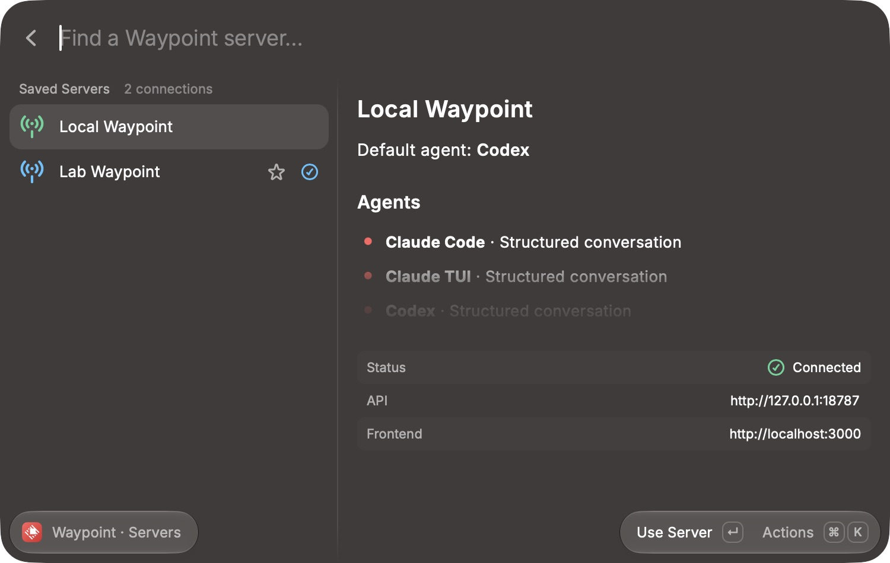
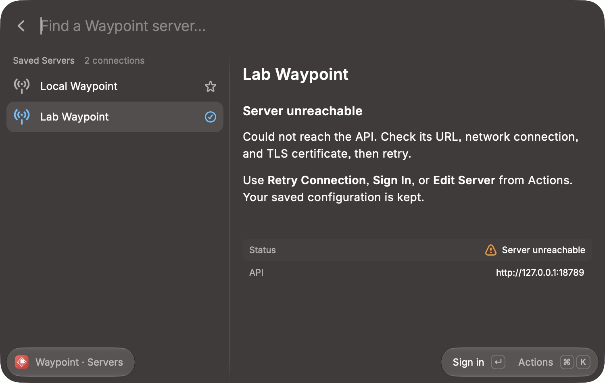
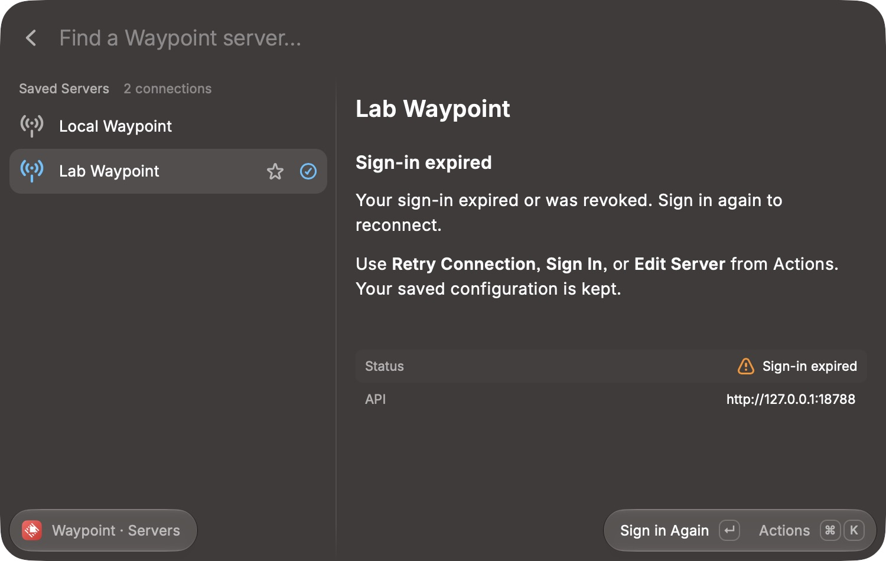

# Server connection acceptance

Manual acceptance on 2026-10-24 used the installed macOS Raycast app, the development extension, and two isolated instances of the real Waypoint backend on loopback ports 18787 and 18788. The instances used separate data directories and disposable passwords. No sessions or agents were launched.

## Desktop checks

| Scenario                                                                | Observed result                                                                           |
| ----------------------------------------------------------------------- | ----------------------------------------------------------------------------------------- |
| Launch Manage Servers with no connections                               | Native empty view offers Add Server                                                       |
| Save a named server with a trailing-slash API URL and optional frontend | Normalized API address, active/default markers, reachable signed-out view                 |
| Submit an incorrect password                                            | Actionable password error; form and connection remain available                           |
| Submit the correct password                                             | Connected state and actual Waypoint agent/transport metadata                              |
| Add and authenticate a second server                                    | Independent sign-in required; both instances remain accessible with their own credentials |
| Use Server on the second connection                                     | Active connection changes independently of the default                                    |
| Leave and reopen Manage Servers                                         | Active connection, URLs, default, and authenticated state survive                         |
| Make the second connection default                                      | Default marker moves without changing credentials                                         |
| Change the second API URL to an unused port                             | Recoverable unreachable view; server remains configured                                   |
| Restore the original API URL                                            | Fresh sign-in required; former credentials are not restored                               |
| Expire tokens in the isolated second backend and retry                  | Sign-in expired state with reauthentication action                                        |
| Reauthenticate                                                          | Connected state returns with active/default choices preserved                             |
| Select the first connection after second-server reauthentication        | First server remains independently authenticated                                          |
| Invoke Remove                                                           | Confirmation describes local removal; cancel leaves connections intact                    |

The keyboard paths for Add, Edit, Retry, Make Default, and Remove were exercised. The Actions popup could not be verified through the available computer-use surface; individual actions were exercised through their keyboard shortcuts or primary buttons. Final removal was not confirmed in the desktop pass; automated storage tests verify credential deletion and fallback selection. Browser handoff and a remote SSH target were not exercised.

## Automated checks

`npm run verify` covers formatting, ESLint, strict types including tests, 19 behavior/integration tests, Raycast manifest/icon validation, and build. The tests cover URL normalization, corrupt/unsupported storage versions, round trips, concurrent mutations, credential isolation, reauthentication, URL identity changes, removal, HTTP auth/error handling, timeouts, rejected redirects, catalog sanitization, late responses after switching or cancellation, delayed form completion after navigation away, and SSH authentication status.

There is no automated desktop end-to-end suite. The desktop checks above were performed with computer use against the native app and actual backend.

## Screenshots

