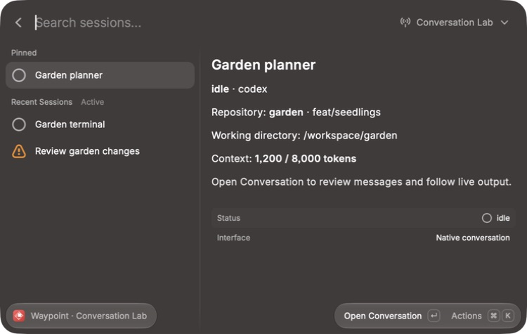
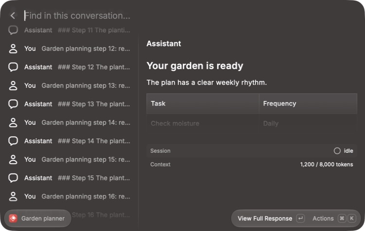
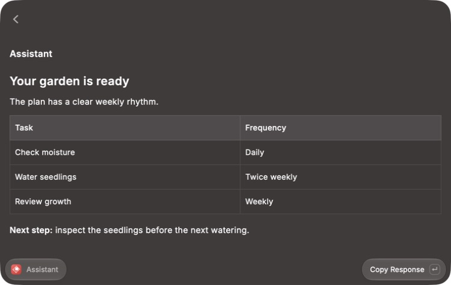
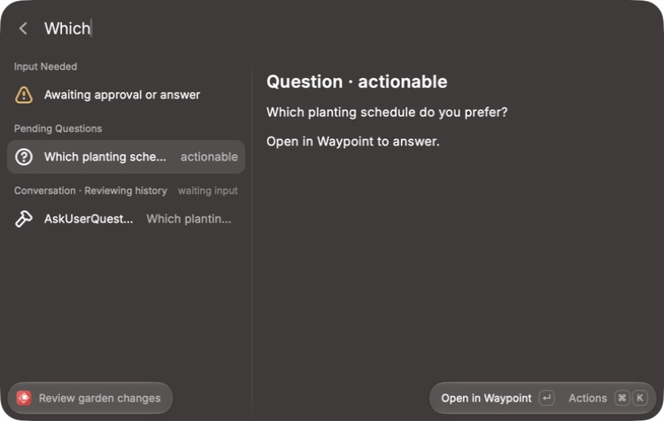
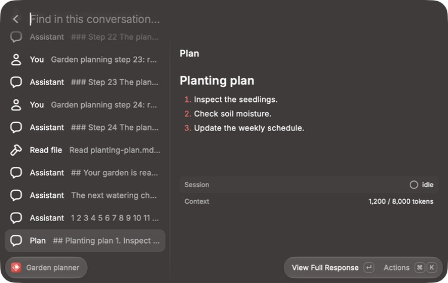

# Session conversation acceptance

The macOS Raycast desktop pass used the development extension, two isolated Waypoint API instances, and sanitized stored conversations. The conversation instance used the real backend's authentication, session/history routes, storage pagination, and WebSocket subscriptions. Its agent-launch lifespan was disabled; a test publisher supplied recorded output and state changes. No agents or private sessions were used.

## Desktop coverage

| Scenario                                         | Observed result                                                                                                         |
| ------------------------------------------------ | ----------------------------------------------------------------------------------------------------------------------- |
| Open Search Sessions                             | Saved active connection restores; pinned and recent sessions appear                                                     |
| Search branch and agent metadata                 | Matching sessions remain visible                                                                                        |
| Search an exited session                         | Hidden by default; Show Exited Sessions reveals it without clearing the search                                          |
| Switch between recording and empty servers       | Each server shows its own sessions; search text and filtering stay consistent                                           |
| Open a structured session                        | Bounded history loads and the latest assistant response is selected                                                     |
| Publish recorded output deltas                   | The selected assistant message updates in place                                                                         |
| Select an older response                         | Following pauses                                                                                                        |
| Load older history                               | Earlier rows appear; selected response remains readable                                                                 |
| View Full Response                               | Markdown headings, lists, and a table render at full width                                                              |
| Copy Response                                    | Raycast confirms Copied to Clipboard                                                                                    |
| Stop the recording API                           | Loaded history and selected response remain visible with a connection error                                             |
| Restart after a delivery gap                     | Automatic recovery retains selection and catches up stored events; recovered text matched 160 distinct database records |
| Open a canonical completed-plan event            | Full plan body renders as the selected latest response                                                                  |
| Open a waiting session                           | Input-needed notice and a session-wide pending question appear                                                          |
| Select the pending question                      | Question and availability render with Open in Waypoint                                                                  |
| Select a terminal session                        | Browser handoff replaces the native conversation action                                                                 |
| Expire the recording server's tokens and refresh | Sign-in expired state preserves loaded sessions                                                                         |
| Sign in again                                    | Session browsing resumes with the saved connection                                                                      |

Keyboard paths exercised Add/Sign In through Manage Servers, Show Exited Sessions, server dropdown navigation, Follow Latest, Load Older, Refresh, and sign-in recovery. An initial list-selection issue and a search-state mismatch across server switches were found during the pass and fixed before the final checks.

The Actions popup and actual browser navigation were not verified through computer use. Browser URLs and terminal/unknown-transport routing are covered by tests. Real agent execution, and native answers/composition were not exercised. There is no automated desktop e2e suite.

## Automated coverage

`npm run verify` checks formatting, ESLint, strict types, 42 behavior/integration tests, Raycast manifest/icon validation, and build. Tests cover event identity and ordering, provider output/tool recordings, canonical plan snapshots, hidden-view pause/resume, overlapping REST/live history, cross-page tools, older-message selection, reconnect recovery beyond a tail page, ID-less history fallback, session/question snapshot races, auth expiry and close 4401, malformed envelopes, disposal, filtering, transport gating, and credential isolation. A real loopback WebSocket test verifies Node's native WebSocket JSON delivery and auth close handling.

## Screenshots

