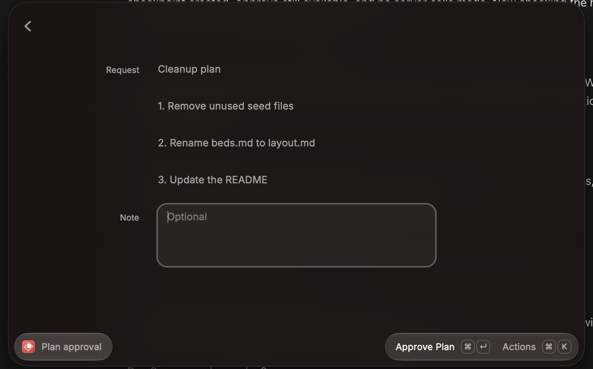
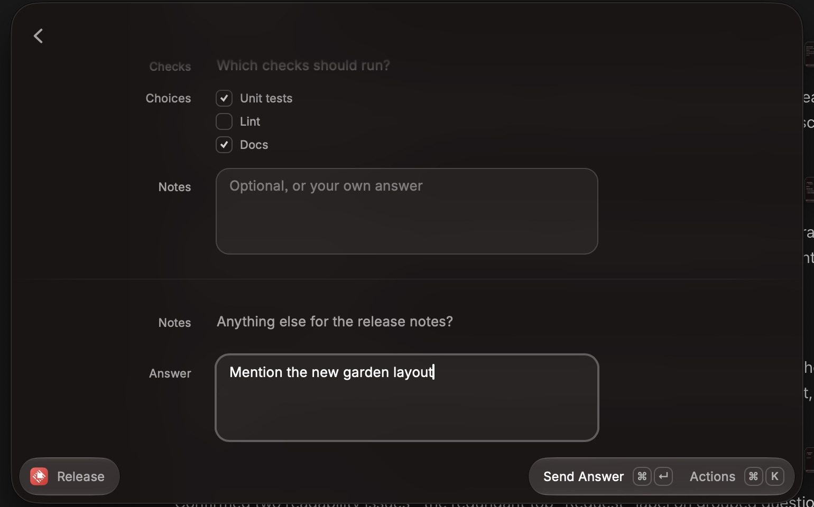
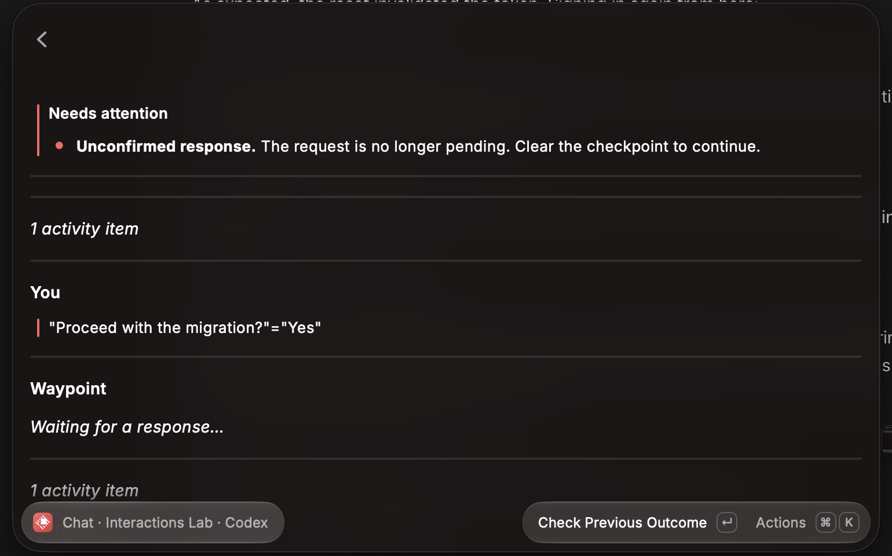

# Session interactions acceptance

The macOS Raycast pass used the development extension and an isolated Waypoint API with a disposable password and data directory. The instance used Waypoint's actual authentication, session/history routes, approval/plan/question endpoints, pending-question snapshots, storage, WebSockets, and Codex adapter and plugin. A fake Codex SDK client replaced the agent, so approvals blocked on the real adapter, plan decisions and question answers produced the agent's real reply envelopes, and no commands or model calls ran. Fixture middleware dropped one response after processing, returned 503, or returned 401 on demand. No private sessions or real tool requests were used. The pass drove Raycast with keystrokes and checked each outcome against the server's stored events and the fake agent's received input.

## Desktop coverage

| Scenario                                      | Observed result                                                                                                                              |
| --------------------------------------------- | -------------------------------------------------------------------------------------------------------------------------------------------- |
| Open a session waiting for approval           | Needs attention lists the request; Review Request is the primary action                                                                      |
| Review a Codex approval                       | Approve, Approve for Session, and Decline match the advertised decisions; no note field because Codex does not support one                   |
| Approve                                       | Waypoint records the response with the captured approval ID; the form closes and the agent's continuing output streams into the conversation |
| Decline a new request                         | Waypoint records the decline with its ID; the command is not run                                                                             |
| Approve a Codex plan with a note              | Waypoint records `accept` for the plan item; the agent receives the plan and the note                                                        |
| Answer a grouped question                     | Single choice with descriptions, multiple choice, and free text submit as structured answers matching the Waypoint frontend                  |
| Leave and reopen a partly answered question   | Selections and notes are restored; nothing is sent                                                                                           |
| Cancel a question                             | Confirmation distinguishes cancelling from closing; Waypoint records the cancellation                                                        |
| Replace a request while its form is open      | The form switches to "resolved or replaced" and offers no decision; the replacement stays pending                                            |
| Lose the response after Waypoint processes it | A durable checkpoint replaces the form actions with Check Previous Outcome; nothing is resent                                                |
| Open Quick Chat with that checkpoint          | Quick Chat keeps its own conversation, names the affected session, and creates or sends nothing                                              |
| Check the outcome and clear the checkpoint    | The resolved request offers Clear Checkpoint without a retry warning; the attention summary clears                                           |
| Submit while the server is offline            | The pre-submit check fails with a server message; no checkpoint is written and Approve remains available                                     |
| Submit after the sign-in expires              | The sign-in message appears; no checkpoint is written                                                                                        |
| Open Conversation History                     | The shared Needs Attention row appears above the transcript                                                                                  |

The pass found and fixed three presentation issues before the final checks: request context collapsing onto one line with raw Markdown, a duplicated request title, and repeated unconfirmed-response copy. The reader now also shows the result of Check Previous Outcome.

Not exercised natively: OpenCode nested approval IDs, `permission.replied`, and positional answers; Claude plan-mode approvals and approval notes; Quick Chat's own list rows for a request in its current session (the same section renders in Conversation History); Windows. These paths are covered by unit and integration tests. Browser handoff URLs were not opened.

## Automated coverage

`npm run verify` checks formatting, ESLint, strict types, 97 behavior and integration tests, Raycast validation, and build. Interaction tests cover sanitized event metadata, approval queues across flat, nested, invalidation, and `permission.replied` resolutions, advertised decisions, live-status gating, Waypoint's current-plan rules, question shape validation, exact answer serialization including OpenCode limits, HTTP outcome classification, storage validation, history watermarks, snapshot ordering across refreshes and the live feed, replaced and changed requests, unconfirmed and definitive outcomes, storage failure after acknowledgement, completion after closing, draft pruning, and coordination with Quick Chat.

## Screenshots

