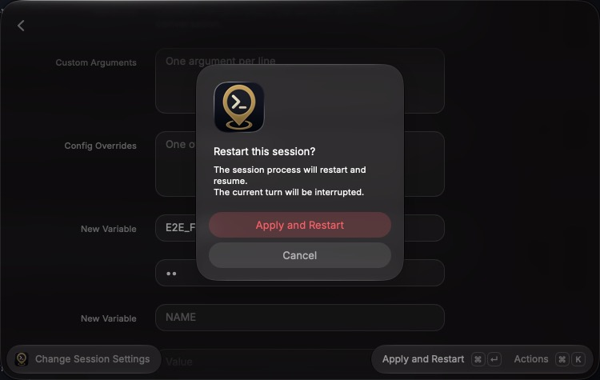

# Session settings acceptance

The macOS Raycast passes used the development extension in three setups.

The isolated pass ran an isolated Waypoint API with a disposable password and data directory. It used Waypoint's actual authentication, sessions, launch settings, restarts, and the Codex adapter and plugin. A fake Codex SDK client replaced the agent. A fake password-auth SSH target had its ControlMaster connect and status patched, so no SSH connection was made. Fixture middleware rejected one model change or returned one lifecycle conflict on demand.

The real-server pass ran against the user's own Waypoint server:

- **Sessions:** a Codex session (GPT-6-Luna, low effort, Auto review) and a Claude Code session were created in a scratch folder with the Waypoint CLI. Their IDs were recorded, and they were deleted afterwards; the server's session list matched its baseline.
- **Raycast state:** the conversations were opened from Search Sessions, so Quick Chat's state on that server was not touched. The active server was restored afterwards.

A later isolated pass covered Change Session Settings in its current form, with the same kind of isolated API added to Raycast as a temporary server and removed afterwards.

All passes drove Raycast with keystrokes and read the form through macOS accessibility. Each outcome was checked against the session record, its launch settings, and its system events.

## Desktop coverage

| Scenario                                                                                 | Observed result                                                                                                                                                                    |
| ---------------------------------------------------------------------------------------- | ---------------------------------------------------------------------------------------------------------------------------------------------------------------------------------- |
| Change the title and effort of a Codex session (real server)                             | The preview reads "Applies now: title, effort."; both apply without a restart or confirmation                                                                                      |
| Add an environment variable to a Codex session (real server)                             | The preview and a confirmation say the session restarts and resumes; Waypoint records the restart and the new key, never the value; a follow-up recalls earlier context            |
| Change effort on Claude Code's native interface (real server)                            | The preview says the session restarts and resumes; the interface options leave out the terminal interface                                                                          |
| Stage a restart while a turn is running                                                  | The preview adds "The current turn will be interrupted."                                                                                                                           |
| A later change fails after the title applied                                             | The form shows "Partly applied", names the applied title and the rejected model change, and the preview lists only the model; applying again sends only the model                  |
| Waypoint reports another lifecycle operation                                             | Nothing is applied, the form says to wait and apply again, and the retry succeeds                                                                                                  |
| Restart a session on a password-auth SSH target that isn't connected                     | The form names the target; Connect SSH Target takes the password once; applying again restarts the session                                                                         |
| Open Change Session Settings (⌘⇧,) from Quick Chat, New Chat, and a Browse Sessions chat | The top line reads "Codex · Chat · Local · <folder>"; there are no agent, target, or folder fields; the interface reads "Chat. Terminal interfaces are available in Waypoint."     |
| A session with no stored variables                                                       | The Advanced group ends with an empty New Variable row; ⌘N moves focus to it                                                                                                       |
| Type a new variable's name and value, then apply                                         | Another empty row appears while typing; the preview and confirmation say the session restarts and resumes; Waypoint stores the variable with the typed value                       |
| Type a new variable with a stored variable's name                                        | The form says "E2E_FLAG is already set. Replace it instead."; Remove New Variable clears the row                                                                                   |
| Replace, then remove, the stored variable                                                | Waypoint stores the replacement value, then no longer lists the variable                                                                                                           |
| A restart that Waypoint can't restore (the fake agent keeps no transcript)               | The form shows "Partly applied", says the settings were saved but the session didn't restart, and offers Reattach Session; the stored variable is listed and one empty row remains |
| Change only the title                                                                    | The preview reads "Applies now: title."; it applies without a confirmation and the form closes                                                                                     |
| Type a custom model ID                                                                   | The model dropdown shows it as a custom choice while typing, and applying sets it on the session                                                                                   |
| Type a custom model ID in Quick Chat Defaults that passes through listed IDs             | The whole ID stays in the field and the model dropdown shows it as a custom choice                                                                                                 |

The pass found and fixed:

- The editor losing its state because its parent rebuilt the connection on every render.
- A typed custom model being reset by the model dropdown on each keystroke, in the editor and in Quick Chat Defaults.
- The interface field naming the agent ("Codex") where the top line and the Waypoint web app name the interface ("Chat").

After Connect SSH Target closes, keyboard focus does not return to a form field, so a shortcut submits only after a field is focused.

Not exercised natively:

- Account profile switching, which would move a real session between accounts.
- Interface switching and usage-source changes.
- An apply whose restart outlasts the form.
- Reattach after a failed restore.

Unit and integration tests cover these paths.

## Automated coverage

`npm run verify` checks formatting, ESLint, strict types, 336 behavior and integration tests, Raycast validation, and build.

Session settings tests cover:

- **Plans:** change plans for Codex, Claude Code's native and TUI interfaces, and OpenCode, including Waypoint's own captured capability catalog. They also cover restart counting, interruptions, and status gating.
- **Values and choices:** default and custom model choices, the three effort states, and dropdowns that always include the current value.
- **Environment:** protected keys, variable validation, and the trailing empty row kept through edits, removal, and reloads after applying.
- **Applying:** the exact request order and bodies; partial success with step-wise replanning; lifecycle, starting, and SSH conflicts; restore failure and reattach; unconfirmed restarts; and settings or capabilities that changed elsewhere.
- **Context:** the top line's agent, interface, target, and folder, using the Waypoint web app's interface names.
- **Earlier versions:** a create saved by Edit Current Session still decodes and reconciles.

## Screenshots

