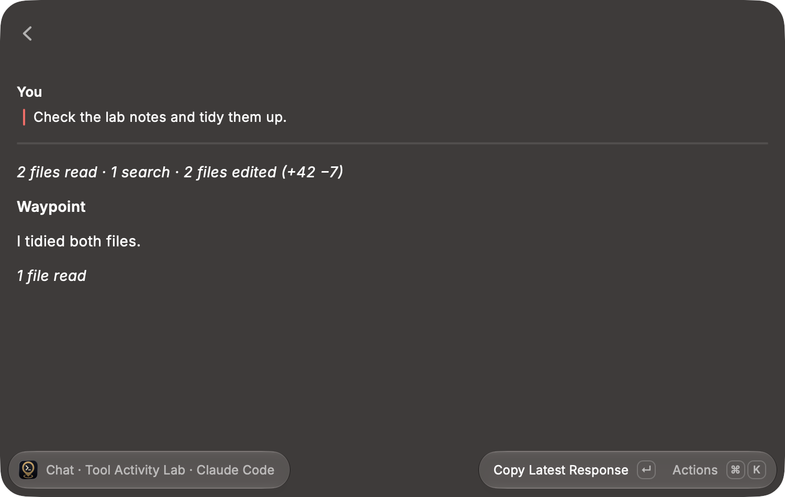
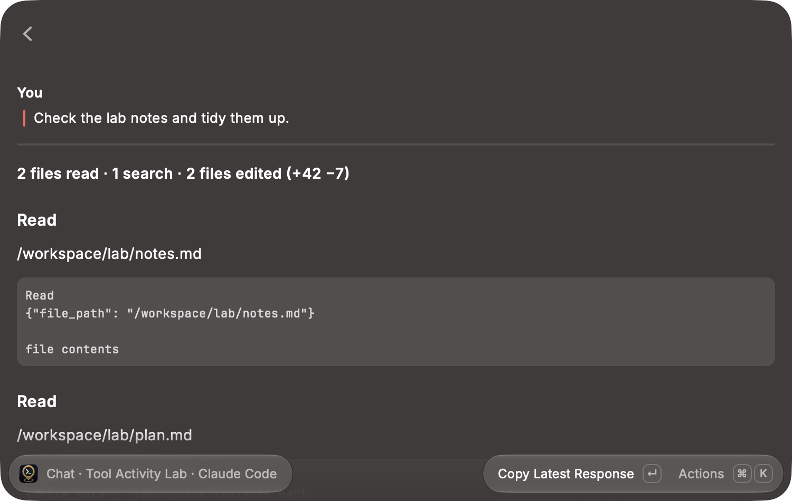
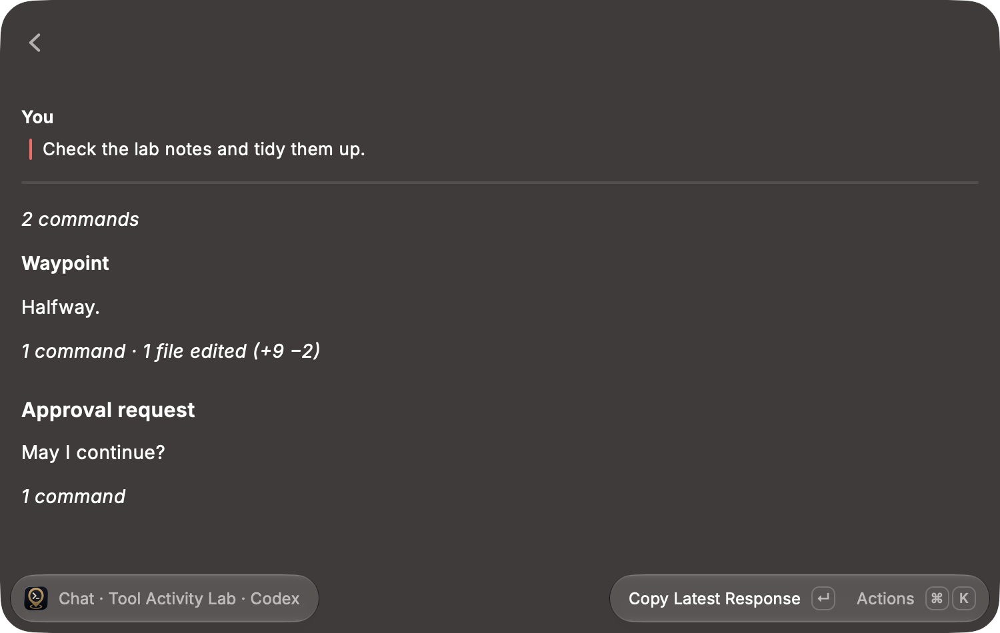
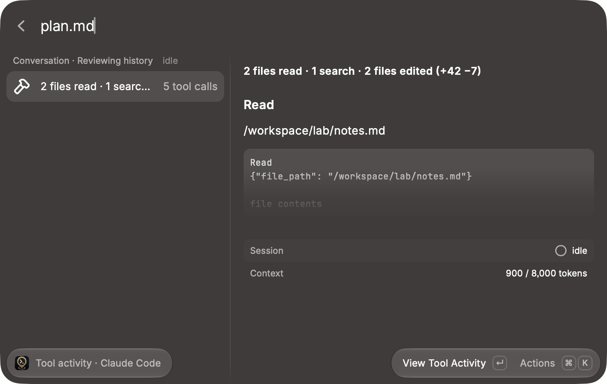

# Tool activity acceptance

The macOS Raycast desktop pass used the development extension against an isolated Waypoint API instance, followed by a read-only check against a personal Waypoint server. The isolated instance ran the real backend's authentication, session, history, and WebSocket routes, with recorded events in each agent's wire shape. Its agent-launch lifespan was disabled, so no agents ran. On the personal server, existing conversations were only opened and read; nothing was sent, changed, or chosen for Quick Chat.

## What each agent reports

The classifier reads the fields each backend emits, established by surveying 168,968 recorded tool events across the four backend/transport pairs:

|             | Codex                                            | Claude Code (structured)    | Claude TUI                  | OpenCode                         |
| ----------- | ------------------------------------------------ | --------------------------- | --------------------------- | -------------------------------- |
| Tool name   | on `item/*` events                               | yes                         | yes                         | yes                              |
| Arguments   | `payload.item.command`, `payload.item.changes[]` | `payload.input`             | `payload.input`             | `tool_input`                     |
| Edit counts | `diff_preview` (`proposed`, then `applied`)      | `diff_preview` (`proposed`) | `diff_preview` (`applied`)  | `state.metadata.filediff`        |
| Reads       | none; a read arrives as a shell command          | `Read`                      | `Read`                      | `read`                           |
| Failure     | `is_error` on `item/completed`                   | `is_error` on `tool_result` | `is_error` on `tool_result` | no flag; the `tool.error` method |

## Desktop coverage

| Scenario                                         | Observed result                                                                       |
| ------------------------------------------------ | ------------------------------------------------------------------------------------- |
| Claude Code run of reads, a search, and edits    | `2 files read · 1 search · 2 files edited (+42 −7)`, between the prompt and the reply |
| A single call after the reply                    | `1 file read`                                                                         |
| Show Activity                                    | Each call shows its path or pattern; edits show `+12 −3` and `+30 −4`                 |
| Hide Activity                                    | The summary line returns; no "activity items" line remains                            |
| Codex commands, a file change, and a todo update | `3 commands · 1 file edited (+5 −1) · 1 todo update`                                  |
| OpenCode commands, an edit, and a failed command | `3 commands · 1 file edited (+7 −2)`; expanded, the failure is titled `bash · Error`  |
| A reply inside a burst of calls                  | Splits it into `2 commands` and the run after the reply                               |
| A lifecycle note inside a burst of calls         | Folds in: `1 command · 1 file edited (+9 −2)`                                         |
| An approval request between calls                | Splits the run; the approval keeps its own card                                       |
| An unknown tool                                  | `1 tool call`                                                                         |
| AskUserQuestion                                  | Stays out of the run, under Needs Attention                                           |
| Conversation History                             | Runs collapse into one row each, subtitled `5 tool calls` and `1 tool call`           |
| Search `plan.md` with a run selected             | Only the run containing it remains; the selection holds on every keystroke            |
| View Tool Activity, then Copy Tool Activity      | The expanded list opens; the clipboard holds every call's text                        |
| Quick Chat on the same session                   | Collapses and expands as in the conversation reader                                   |

Actions were run from the Actions panel (⌘K). SendUserFile staying out of runs is covered by tests only.

## Personal server check

Four existing conversations were opened read-only: Codex, OpenCode, Claude TUI, and Claude Code. For each, the summaries the extension rendered from the served history page were compared with an independent recount from the server's database over the same events. All runs agreed on kinds and counts.

The pass found one defect, fixed before this record: a single Codex file change can add, delete, and update several files, and the summary counted only its first path (`1 file edited` for a change touching three files). Edits now count every file the backend reports, and the expanded call lists them all. The corrected Codex conversation reads `5 commands · 3 files edited (+5 −5)` and `8 commands · 3 files edited (+15 −15)`, matching the database.

The first run on a history page can be partial when the page boundary falls inside it; Load Earlier Messages completes it.

## Automated coverage

`npm run verify` checks formatting, ESLint, strict types, 223 behavior and integration tests, Raycast manifest/icon validation, and build. Tests cover classification for each backend's event shape, Codex item-type classification where no tool name is present, MCP and unknown-tool fallbacks, the flat-text fallback for a call with no structured fields, OpenCode's method-based failure, clause ordering and pluralization, distinct-file counting for reads and edits including multi-file changes, run boundaries across assistant text, approvals, notes, and standalone cards, and the omitted diffstat when no backend reported counts.

## Screenshots

